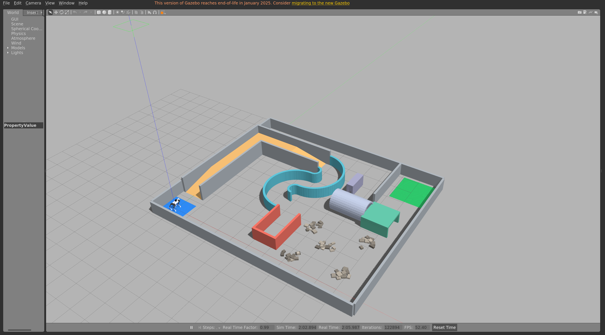
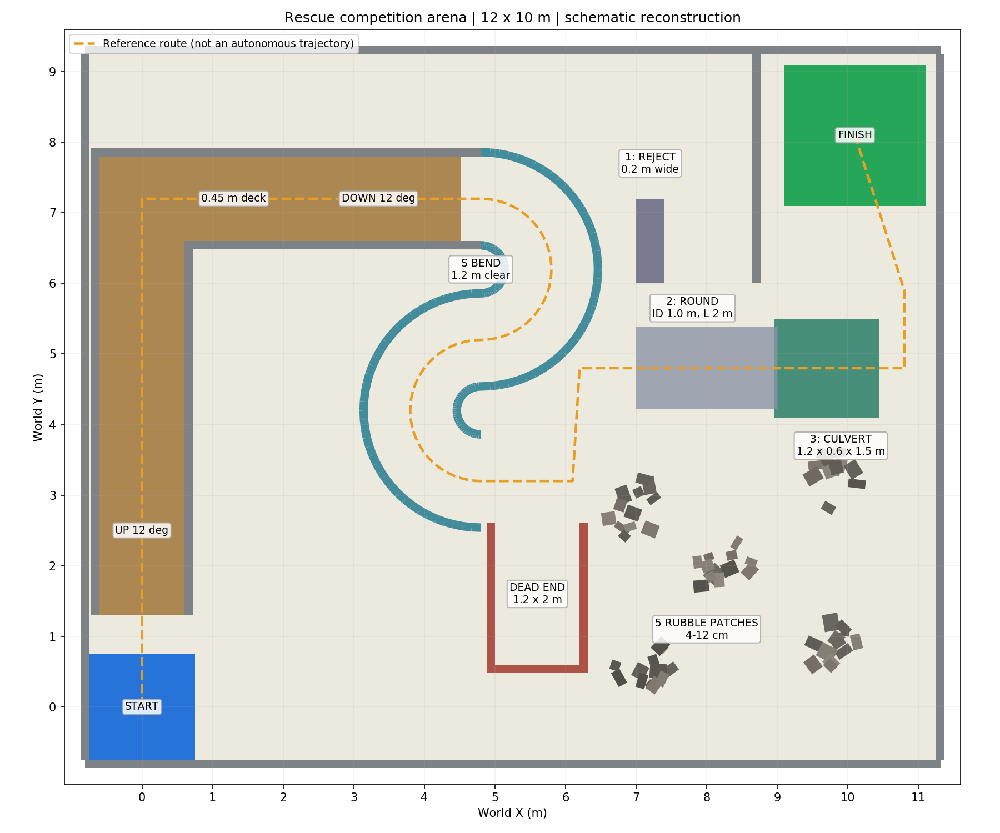
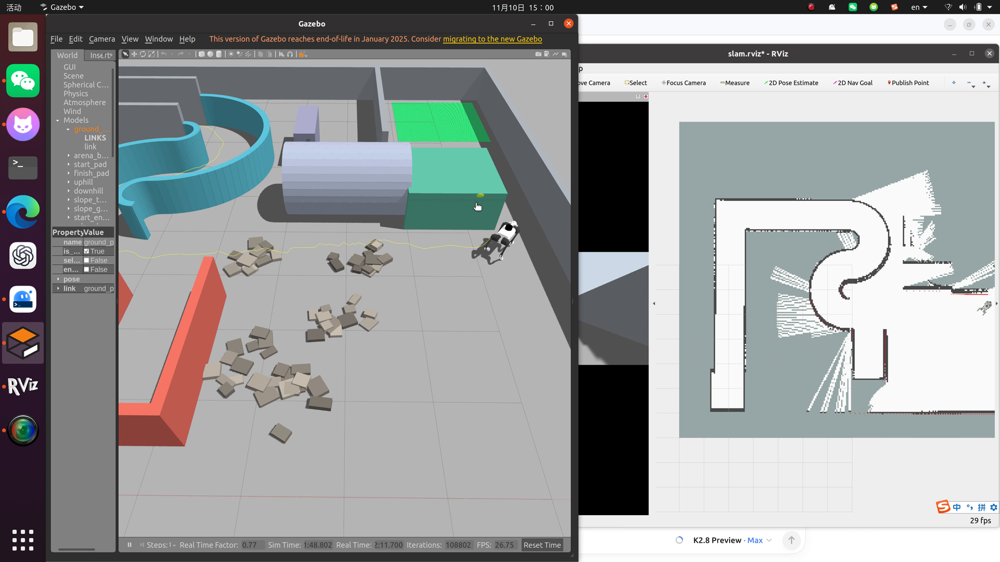

# Unitree Go1 “废墟智援”比赛仿真工作区

这个项目在宇树开源仿真 [macc-n/ros_unitree](https://github.com/macc-n/ros_unitree) 的基础上，用 **ROS Noetic + Gazebo 11** 复现了 **Go1 四足机器人**的仿真，并按照《人工智能+竞赛》“废墟智援”赛题附录，搭建了一座 **12×10 米比赛场地的示意模型**：

- 上下坡（约 12°）、S 弯、死胡同（需要倒退退出）
- 五处碎石堆（每处 12 块可碰撞石块）
- 三种管道：过窄应放弃的方管、可通过的圆管、限高方涵
- 起点 / 终点地面标记

目前已跑通的能力：Go1 站立与低速行走、Gmapping 激光建图、AMCL 定位 + move_base/DWA 到点导航（原房间场景误差约 0.056 米）。





> 注意：场地是按赛题附图做的**示意重建**，尺寸取自图中标注，细节是建模选择，**最终以组委会公布的场地为准**。

## 当前实现与比赛任务的对应关系

| 比赛要求 | 本项目现状 |
| --- | --- |
| 任务 1：非结构化地形运动控制、动态避障、路径规划 | 场地模型已完成；**自主探索已跑通**（explore 模式：前沿探索自动走遍场地并建图）；Gmapping + AMCL + DWA 导航基线已跑通（房间场景） |
| 上下坡 / 狭窄通道 / 乱石越障 | 场景中已建模（坡 12°、S 弯弯宽 1.2 m、障碍空地五处碎石），机器人可自主通过上坡与 S 弯 |
| 任务 2：生命目标识别与信息采集 | **尚未实现**（需要相机检测算法，后续方向） |
| 隧道 1 识别后放弃、倒退决策、低姿态过管 | 尚未实现 |
| Go2 机体、原生雷达、D435i 相机、弱光、动态障碍 | 尚未适配 |

自主探索演示：

```bash
./run_competition.sh explore
```

机器人会自己从起点出发：上坡（L1）→ 转弯平台下坡 → S 弯（L2）→ 死胡同分岔 → 障碍空地（五处碎石）→ 管道区（L3），边探索边建图，无需遥控。按 L1→L3 的线性路线组织场地，对应比赛任务的递进难度。



## 环境要求

| 项目 | 要求 |
| --- | --- |
| 操作系统 | Ubuntu 20.04 |
| ROS | ROS Noetic（`ros-noetic-desktop-full`） |
| Gazebo | Gazebo 11（随 ROS Noetic 自带） |
| Python | 系统 Python 3.8 + `python3-venv` |
| 硬件建议 | 内存 ≥ 8 GB；虚拟机需开启 3D 加速，否则 Gazebo 可能黑屏 |

本仓库只包含项目代码，**不包含操作系统和 ROS**，需要先自行装好 ROS Noetic。

## 快速开始（5 步跑通比赛场地）

```bash
# 1. 克隆本仓库
git clone https://github.com/liangjihui643-beep/unitree_map_nav.git
cd unitree_map_nav

# 2. 下载上游宇树代码并打上本项目的适配补丁
bash scripts/restore_upstream.sh

# 3. 准备 Python 虚拟环境
python3 -m venv .venv
.venv/bin/pip install pyyaml matplotlib

# 4. 安装额外 ROS 依赖（LCM、gmapping、控制器等；有 sudo 直接装，没有则自动下载解包到本地）
bash scripts/install_deps.sh

# 5. 编译
./scripts/build.sh
```

启动比赛场地（Gazebo + RViz）：

```bash
./run_competition.sh mapping
```

看到 Gazebo 里的场地和 RViz 里的激光点云后，在**另一个终端**里遥控机器人慢慢走：

```bash
source activate.sh
# 以 0.08 m/s 低速前进（约 1.4 m 身高步态下比较稳）
rostopic pub -r 10 /cmd_vel geometry_msgs/Twist '{linear: {x: 0.08}}'
# 想停下：先按 Ctrl+C 中断上面的命令，再发一条零速度
rostopic pub -1 /cmd_vel geometry_msgs/Twist '{}'
```

走完一圈后保存地图，再启动导航模式：

```bash
rosrun map_server map_saver -f src/unitree_competition/maps/competition
./run_competition.sh navigation
```

> 新下载的仓库里**没有现成的比赛地图**，`src/unitree_competition/maps/` 需要按上面的步骤自己建。仓库里 `src/unitree_local_demo/maps/demo_room.pgm` 是简单房间场景的示例地图，仅供演示，不能用在比赛场景。

## 常用命令

| 目的 | 命令 |
| --- | --- |
| 启动比赛场景（建图 / 导航 / **自主探索**） | `./run_competition.sh mapping` / `./run_competition.sh navigation` / `./run_competition.sh explore` |
| 启动原房间演示 | `./run_demo.sh mapping` / `./run_demo.sh navigation` |
| 后台启动（不显示窗口） | `python3 scripts/session.py start mapping --scene competition --headless --no-rviz` |
| 查看 / 停止后台会话 | `python3 scripts/session.py status` / `python3 scripts/session.py stop` |
| 一键自检（场景、传感器、碰撞） | `source activate.sh && python3 scripts/verify_competition.py` |
| 重新编译 | `./scripts/build.sh` |
| 修改场地参数后重建 | 编辑 `src/unitree_competition/config/arena.yaml`，然后 `python src/unitree_competition/scripts/generate_world.py` |

## 目录结构

```
unitree_map_nav/
├── run_competition.sh / run_demo.sh   # 一键启动脚本（比赛场地 / 房间场景）
├── activate.sh                        # source 它获得本工作区的 ROS 环境
├── scripts/
│   ├── restore_upstream.sh            # 克隆上游 + 打补丁
│   ├── install_deps.sh                # 安装额外 ROS 依赖
│   ├── build.sh                       # catkin_make 编译
│   ├── session.py                     # 后台启动/停止/查看仿真会话
│   ├── verify_competition.py          # 比赛场景自检脚本
│   └── setup_env.bash                 # 环境变量（被 activate.sh 调用）
├── src/
│   ├── ros_unitree/                   # 上游宇树代码（git 忽略，由脚本恢复）
│   ├── unitree_competition/           # 比赛场地：生成器、world、launch、配置、平面图
│   └── unitree_local_demo/            # 简单房间场景 + 示例地图（入门用）
├── patches/ros_unitree-noetic.patch   # 对上游的 Noetic 适配修改
├── config/environment.json            # 上游版本、依赖版本等环境记录
└── models/                            # 地面、太阳等 Gazebo 基础模型
```

编译产物（`build/`、`devel/`）、虚拟环境（`.venv/`）、本地依赖（`.runtime/`）和日志（`logs/`）都不进入 Git。

## 常见问题（FAQ）

**Gazebo / RViz 窗口黑屏或打不开？**
虚拟机请先开启 3D 加速；也可以不显示界面跑：`./run_competition.sh mapping gui:=false rviz:=false`。

**机器人走两步就摔倒？**
速度放慢（0.08 m/s 以内），先让机器人站稳再发指令；每次只发一个方向的速度。

**提示端口被占用 / 会话已存在？**
一次只能跑一个仿真：`python3 scripts/session.py stop` 停掉再启动。

**换电脑后编译报错找不到包？**
确认第 2、4 步做过（恢复上游 + 装依赖），再重新 `./scripts/build.sh`。

**想改场地尺寸？**
改 `src/unitree_competition/config/arena.yaml` 后运行生成器并重启 Gazebo，见 [比赛场地包说明](src/unitree_competition/README.md#修改尺寸及重建)。

## MuJoCo 训练环境（feat/mujoco-env 分支）

比赛官方训练/评测链路为 **MuJoCo 3.17.0 + ONNX**（见赛题 PPT）。本仓库
`feat/mujoco-env` 分支把同一份比赛场地配置搬进了 MuJoCo：Go2 官方模型
（unitree_mujoco）、按 PPT 契约的传感器（前视 RGB 320×240@10Hz、72×9 线
360° 激光@10Hz、IMU/编码器@50Hz）、出生点/碎石/足球生命体每回合随机化、
ONNX 导出与 onnxruntime 1.31.1 本地验证脚本。Gazebo 分支继续做系统集成
验证，两者共享 `arena.yaml` 几何真源。详见 [mujoco_env/README.md](mujoco_env/README.md)。

## 官方评测环境（feat/official-env 分支）

比赛官方训练资源包（Go2 MuJoCo 物理权威 + 完整赛道 MJB + 足球目标）的最小完赛
集成在该分支：`official/go2_stack/`（环境封装 / 可插拔行走后端 / 建图规划导航 /
终点判定与结束信号），宇树开源训练框架（unitree_rl_gym / unitree_rl_mjlab）的
接入说明见 [official/README.md](official/README.md)。评测固定版本
MuJoCo 3.17.0 + onnx 1.23.2 + ONNX Runtime 1.31.1 + Python 3.12。

## 上游代码与许可证

- 上游：[macc-n/ros_unitree](https://github.com/macc-n/ros_unitree)，固定版本 `0c7b48ade880fd9096d196123b3f9c98ea1131b3`（见 `config/environment.json`）。
- 上游使用 **BSD-3-Clause** 许可证（Copyright © Unitree Robotics），LICENSE 文件随上游代码一起保留；本项目的适配修改见 `patches/ros_unitree-noetic.patch`。
- 比赛场地为按赛题附图的示意重建，仅供备赛开发，以组委会发布为准。
