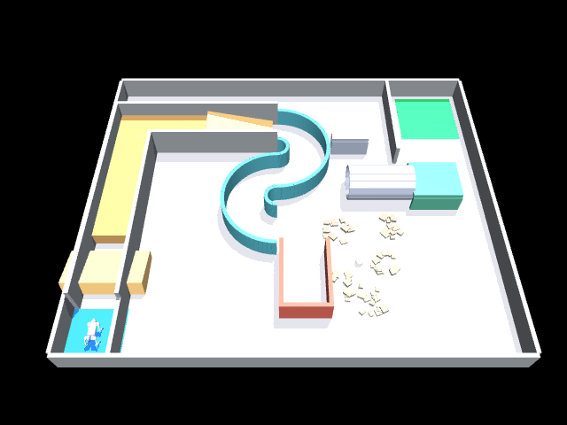

# MuJoCo 训练环境（Go2 · 废墟救援赛场）

对应比赛 PPT 的官方训练链路：**MuJoCo 3.17.0 + Python 3.12，策略导出 ONNX，
onnxruntime 1.31.1 评测**。本目录把 Gazebo 版的比赛场地（同一份
`src/unitree_competition/config/arena.yaml` 几何真源）搬到了 MuJoCo，
并按 PPT《实机本体》的仿真契约提供传感器。



## 环境要求（与官方评测对齐，务必一致）

| 依赖 | 版本 |
| --- | --- |
| Python | 3.12 |
| MuJoCo | 3.17.0 |
| onnx | 1.23.2 |
| ONNX Runtime | 1.31.1 |

```bash
conda create -n mujoco312 python=3.12 -y
conda activate mujoco312
pip install -r mujoco_env/requirements.txt
```

> 本机（Ubuntu 20.04）自带 Python 3.8 不能跑 MuJoCo 3.x，必须用上面的 3.12 环境。

## 快速开始

```bash
cd mujoco_env
PYTHONPATH=. python tests/smoke_test.py          # 冒烟测试
PYTHONPATH=. python - <<'PY'                      # 手动体验
from go2_arena_env import Go2ArenaEnv
env = Go2ArenaEnv(seed=0)
obs, info = env.reset()
for _ in range(500):
    obs, r, done, trunc, info = env.step(env._stand)   # 站立
PY
```

生成纯场地 xml（不带机器人）：

```bash
python generate_arena_xml.py --output /tmp/arena.xml --seed 1
```

## 传感器契约（按 PPT）

| 传感器 | 参数 | 代码中的 obs 键 |
| --- | --- | --- |
| 关节编码器 | 12 关节（髋外展/屈伸/膝）50 Hz | `joint_pos` `joint_vel`（+`base_quat` 姿态估计必需） |
| IMU | 陀螺仪（机体系角速度）50 Hz | `gyro` |
| RGB 相机 | 前视 320×240 @ 10 Hz（无深度相机） | `rgb`，无新帧时为 `None` |
| 激光雷达 | 72×9 线、水平 360° @ 10 Hz | `lidar`（9×72，量程 0.2–8 m，`nan`=无回波） |

补充说明（PPT 未给出、属于建模假设，环境内已注明）：
激光垂直 9 线取 −15°~+15°、安装高度 0.33 m；相机 fovy=90°、安装于机身前上方
(0.30, 0, 0.14)。官方接口合同发布后，以其为准。

**PPT 明确无**：真实场地坐标、GPS、深度相机。`base_pos` 仅训练辅助，评测策略
不应依赖它（每回合场地布局还会随机化）。

## 动作空间

12 维关节位置目标（rad），顺序 `FR_hip/thigh/calf, FL_*, RR_*, RL_*`，
50 Hz PD 控制（kp=50, kd=3.5，可 `Go2ArenaEnv(kp=, kd=)` 覆盖），底层 500 Hz 物理。
Go2 模型来自 Unitree 官方 `unitree_mujoco`（BSD-3-Clause，见
`robot/go2/SOURCE.txt`），力矩电机 + 关节型。

## 随机化（PPT：不要依赖固定坐标）

- 出生点 ±0.15 m、朝向 ±0.2 rad
- 碎石中心 ±0.4 m
- 足球生命体在 5 个候选区随机出现（`info['victim_pos']` 训练期可见，评测只能靠 rgb/lidar 找）

`Go2ArenaEnv(seed=...)` 固定种子可复现；`randomize=False` 完全按配置坐标（调试用）。

## 任务接口

- `info['in_finish']`：是否进入终点区；`info['dist_to_finish']`
- `env.report_victim(xy)`：上报生命体位置，返回到真值误差（对应"探测信号并报位"）
- `info['in_puddle']`：是否压到坡面浅水洼（评分项"进水洼"）
- 结束信号：到达终点区后由策略侧发出（正式接口以官方合同为准）
- 默认回合上限 60 s，倒地/越界 terminated

## ONNX 提交流程演练

```bash
python scripts/export_policy_onnx.py --output /tmp/policy.onnx   # 占位策略 -> ONNX
python scripts/check_onnx.py /tmp/policy.onnx                     # onnxruntime 1.31.1 验证
```

真实流程：PyTorch 训练 → `torch.onnx.export` → `check_onnx.py` 本地过一遍 →
队长上传平台验证（不计成绩）→ 发起正式评测。

## 与 Gazebo 版的关系

| | Gazebo 版（仓库根目录） | 本目录 |
| --- | --- | --- |
| 角色 | ROS 系统集成验证：建图/导航/探索算法 | 强化学习训练 + 官方评测对齐 |
| 场地来源 | `generate_world.py` 读 arena.yaml | `generate_arena_xml.py` 读同一份 arena.yaml |
| 机器人 | Go1（上游 macc-n/ros_unitree） | Go2（官方 unitree_mujoco） |
| 传感器 | 2D 激光 + 深度相机 + IMU | 按 PPT：RGB + 72×9 激光 + IMU/编码器 |

评测固定版本，本地须对齐——训练环境版本不要自行升级。
