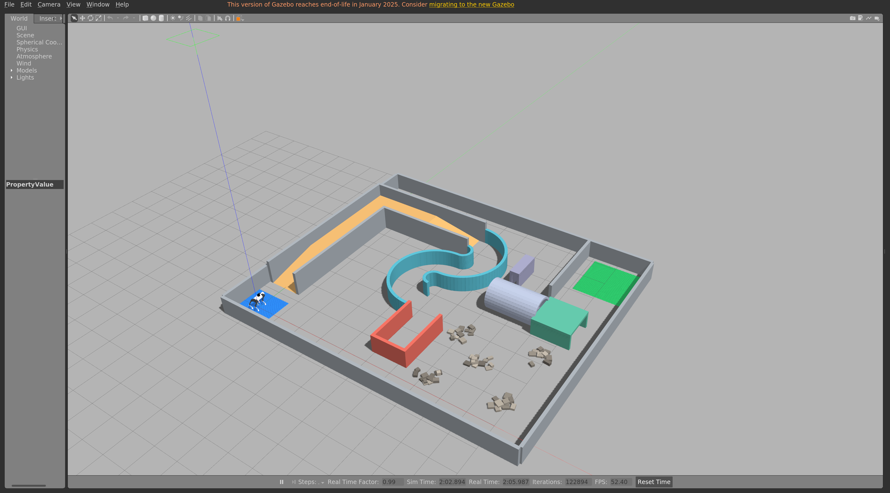
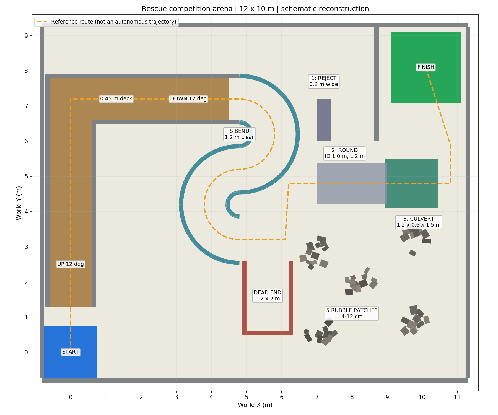

# 比赛场地 Gazebo 模型

依据用户提供的《人工智能+竞赛.pdf》第6页附录建立的**示意重建版**。尺寸取自图中参考标注，位置、墙厚、转弯平台和石块分布是建模选择，不是对官方场地的精确测绘。最终参数以组委会公布的配置为准。

## 场景内容

| 区域 | 模型实现 | 参考尺寸 |
| --- | --- | --- |
| 场地 | 外围实体墙，地面 | 内部12×10m |
| 起点/终点 | 蓝色/绿色地面标记，无额外碰撞台阶 | 1.5×1.5m / 2×2m |
| 上下坡 | 闭合三角网格实体坡面，连续连接高台 | 12°，高0.45m，净宽1.2m，单坡水平投影约2.117m |
| S弯 | 两个反向半圆，分段实体墙 | 净宽约1.2m，中线半径1m |
| 死胡同 | 开口朝北的U形实体墙，需倒退退出 | 净宽1.2m，长2m |
| 碎石 | 五处固定石堆，每处12块可碰撞方石 | 石高4–12cm，随机种子42 |
| 管道1 | 窄口方形通道，用于识别后放弃 | 净宽0.2m；高0.6m、长1.2m是建模假设 |
| 管道2 | 32段实体壳拼接的中空圆管 | 内径1m，长2m |
| 管道3 | 两侧壁和顶板组成的方涵 | 净宽1.2m、净高0.6m、长1.5m |

圆管没有横堵在入口的实心圆柱碰撞体。坡面、石块、墙壁和管壳都参与物理碰撞。碎石目前采用低成本固定方石近似，不模拟石堆滑动或沙土地面。外墙及转弯平台是便于仿真训练的补充。





图中虚线表示区域通行顺序参考，不是可直接执行的规划轨迹。起点世界坐标(0,0)，机器人朝世界+Y方向生成；世界坐标不等同于每次SLAM生成的map坐标。

## 启动

先停止已经运行的本工作区会话：

```bash
cd unitree_map_nav
python3 scripts/session.py stop
./run_competition.sh mapping
```

或在后台启动（不要同时启动两次）：

```bash
python3 scripts/session.py start mapping --scene competition
python3 scripts/session.py status
python3 scripts/session.py stop
```

不显示窗口时添加 `gui:=false rviz:=false`；后台脚本使用 `--headless --no-rviz`。

在另一个终端低速前进，Ctrl+C停止持续发布后，再发送零速度：

```bash
source ./activate.sh
rostopic pub -r 10 /cmd_vel geometry_msgs/Twist '{linear: {x: 0.08}}'
# Ctrl+C 后执行：
rostopic pub -1 /cmd_vel geometry_msgs/Twist '{}'
```

完成场地探索后保存地图。默认没有预制的比赛完整地图，不能使用旧房间地图代替：

```bash
rosrun map_server map_saver -f src/unitree_competition/maps/competition
```

结束建图仿真，再运行 `./run_competition.sh navigation`，也可以传 `map_file:=/绝对路径/地图.yaml`。二维导航沿用原来的Gmapping/AMCL/GlobalPlanner/DWA基线，没有新增比赛自主决策。

## 修改尺寸及重建

编辑 `config/arena.yaml`，然后：

```bash
cd unitree_map_nav
source activate.sh
python src/unitree_competition/scripts/generate_world.py
gz sdf -k src/unitree_competition/worlds/competition.world
```

生成器依赖本机已有的PyYAML和Matplotlib，输出world、坡面STL、生成清单、出生位置launch以及PNG/SVG平面图。修改后重启Gazebo生效，无需重新编译C++。参数中的入口位置应保持互相连通；改变半径或位置后需要重新检查场地布局。

## 验证及边界

```bash
source ./activate.sh
python scripts/verify_competition.py
```

检查场景模型、激光/IMU/里程计/局部SLAM地图、站立姿态，并用临时小方块检查坡面接触及管道内部/顶板碰撞。检查结束删除临时模型；结果输出到 `logs/verification_competition.json`。它不自动驾驶机器人通过全赛道。

2026-11-10本机验证通过：18个场景模型全部加载；五处石堆；激光360个有效返回；机器人起点站立高度约0.334m；起点附近地图6235个已知栅格。6项物理接触检查全部通过，上下坡测试块落点高度约0.228m，圆管/方涵内部落点约0.025m，圆管和方涵顶板落点分别约1.105m和0.725m。该记录只对应当前默认配置。

当前机器人仍是上游支持的**Go1**。还没有Go2机体、原生雷达和D435i的精确配置。已有二维激光SLAM不会表达坡面高度，也可能看不到低矮石块；相机三维避障、窄管识别放弃、倒退决策、低姿态过管、足球识别、动态障碍和弱光测试尚未实现。场景成功加载不代表现有控制器能稳定通过12°坡道、所有碎石和管道。

## Git结构

外层 Git 仓库管理本地ROS包、配置、启动脚本和上游补丁，`main` 保存可运行的房间基线，`feat/competition-arena` 保存本次比赛场景。远程仓库：<https://github.com/liangjihui643-beep/unitree_map_nav>。

`src/ros_unitree/` 保留独立的上游Git克隆，外层忽略该目录；上游URL和固定提交记录在 `config/environment.json`，适配修改记录在 `patches/ros_unitree-noetic.patch`。新检出工作区后可运行 `bash scripts/restore_upstream.sh` 恢复源码与补丁，`bash scripts/install_deps.sh` 安装额外依赖。构建产物、虚拟环境、运行依赖及日志不进入Git。
